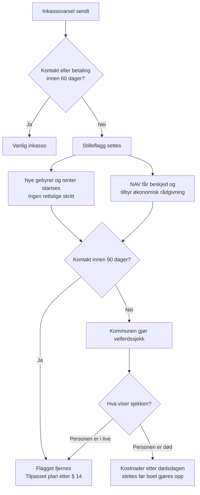

# Forslag: Stilleflagget

*Versjon 1, oktober 2026, med del 6 lagt til i november 2026. Bygger på [analysen](analyse.md), [rettskartet](rettskart.md) og [regnestykket for fristen](fortjeneste-og-frist.md). English summary at the bottom.*

*Forslaget er ute til gjennomgang. Se [spørsmålene vi trenger svar på](gjennomgang.md). The proposal is open for review: see [the questions we need answered](gjennomgang.md#english).*

## Kort oppsummert

Når en skyldner har vært helt stille over tid, skal inkassoforetaket sette et **stilleflagg**. Flagget stopper nye gebyrer, sender et signal til NAV om å ta kontakt, og fører til en velferdssjekk hvis stillheten fortsetter. Gjelden slettes ikke, men den vokser ikke mens ingen vet om personen har det bra. Hvis det viser seg at personen var død, slettes alle kostnader som løp etter dødsdagen.

Den som tar kontakt og dokumenterer at 12 måneder ikke holder, skal dessuten få betale skatt og andre statlige krav over inntil 24 måneder (del 6).

Alle tall i forslaget er utgangspunkt for diskusjon, ikke endelige.

## Slik virker det

## De seks delene

### 1. Utløser: stillhet blir et signal

- Flagget settes når skyldneren ikke har svart på noen kanal (brev, digital post, SMS eller telefon) og ikke har betalt noe, i **60 dager etter inkassovarselet**.
- Inkassoforetaket må sette flagget før saken kan gå videre til tungt salær eller rettslig inndriving.
- Hvorfor 60 dager: tungt salær kan tidligst kreves rundt dag 57. Med regelen over får ingen stille person doblet salær før noen har sett etter. For pengene betyr fristen lite; et flagg på dag 30 eller dag 90 utgjør ca. 100 kroner på et krav på 5 000 kroner ([regnestykket](fortjeneste-og-frist.md)).
- Flagget gjelder personen, ikke saken. Har én kreditor flagget en person, ser andre kreditorer det også (se del 4).

*Svarer på hull 1: stillhet utløser ingenting.*

### 2. Gebyrstopp

- Mens flagget er aktivt, kan det ikke legges på nye inkassokostnader, og forsinkelsesrenter stanses.
- Ingen rettslige skritt (forliksråd, utlegg, trekk i lønn) mens flagget er aktivt.
- Gebyrstoppet varer til kontakt er oppnådd, men maksimalt **6 måneder**. Deretter kan saken gå videre, men bare etter en manuell vurdering.

*Svarer på hull 1 og 5.*

### 3. Henvisning til hjelp

- Når flagget settes, får NAV-kontoret i skyldnerens kommune et varsel med bare navn og adresse. Varselet sier ikke hvem kreditoren er eller hvor mye det gjelder.
- NAV skal da tilby økonomisk rådgivning, slik kommunen allerede har plikt til, med brev og tilbud om hjemmebesøk.
- Skyldneren kan når som helst ta kontakt direkte, og da fjernes flagget.

*Svarer på hull 3: hjelp må oppsøkes.*

### 4. Ett felles flagg

- En enkel offentlig flaggtjeneste der inkassoforetak kan sette og lese et ja/nei-flagg for en person. Ingen beløp, ingen diagnoser, ingen kreditornavn.
- Helsetjenesten, NAV eller en verge kan sette et **pauseflagg** med personens samtykke, eller uten samtykke når personen ikke kan gi det og det er i personens vitale interesse. Pauseflagget gir samme gebyrstopp, uten å si hvorfor.
- Flagget slettes automatisk når det ikke lenger er aktivt.

*Svarer på hull 2 og 4: de som vet, kan ikke si fra, og ingen ser helheten.*

### 5. Velferdssjekk og uoppdagede dødsfall

- Hvis stillheten varer **90 dager etter at flagget ble satt**, skal kommunen gjøre en velferdssjekk, ved behov sammen med politiet.
- Hvis personen viser seg å være død, skal alle inkassokostnader og renter som løp etter dødsdagen falle bort. Har boet eller arvingene allerede betalt dem, skal de betales tilbake.

*Svarer på hull 5: døden tar ingen pause i gebyrene.*

### 6. Tid til å betale: avdrag over inntil 24 måneder

**Slik er det i dag**

- En vanlig betalingsavtale for skatt krever at kravene til sammen er under 100 000 kroner og betales innen 12 måneder, med minst 500 kroner i måneden. Forsinkelsesrenten løper hele tiden. Avtalen kan ikke inngås når skyldneren har fått varsel om utlegg, når Skatteetaten har besluttet trekk i inntekten, eller når skyldneren har hatt avtale for de samme kravene før ([Skatteetaten](https://www.skatteetaten.no/betalingsvansker/betalingsavtale-for-skatte-og-avgiftskrav/)).
- Utenfor disse grensene kan Skatteetaten «unntaksvis» gi en avtale, men bare når den gir «like god eller bedre dekning enn innkreving med andre virkemidler» og ikke kan «svekke den alminnelige betalingsmoralen» (samme kilde).
- For andre krav Skatteetaten krever inn for offentlige etater, som gebyrer, rettsgebyr og tvangsmulkter, kan betalingen deles opp over inntil 24 måneder ([Skatteetaten](https://www.skatteetaten.no/person/betaling-og-innkreving/tema/andre-krav/betalingsavtale/)). Etaten har altså allerede en ordning på 24 måneder, men ikke for skatt.
- Tvangstrekk kan vare lenger enn 12 måneder. Etter de gamle reglene kunne et utleggstrekk som hovedregel løpe i inntil to år, og for skattekrav i inntil fem år ([Skatteetaten, retningslinje for utleggstrekk](https://www.skatteetaten.no/rettskilder/type/retningslinjer/retningslinje-for-utleggstrekk/)). Den nye innkrevingsloven trådte i kraft 1. januar 2026 ([Skatteetaten](https://www.skatteetaten.no/en/about-the-tax-administration/fremtidens-innkreving/)), og de nye reglene for utlegg tas gradvis i bruk gjennom 2026 (retningslinjen). Et nytt, samordnet utleggstrekk «må ikke lenger avsluttes etter to år, men løper til alle kravene i trekket er dekket» ([Skatteetaten](https://www.skatteetaten.no/om-skatteetaten/fremtidens-innkreving/skyldner/)).

**Hvorfor det er et problem**

Den som selv tar kontakt og vil betale, får som hovedregel høyst 12 måneder. Den som ikke klarer å svare, får et trekk som kan løpe lenger, men som er beregnet med standardsatser for boutgifter i stedet for det faktiske boliglånet ([hull 6 i rettskartet](rettskart.md#de-seks-hullene)). Ordningen gir altså kortest tid til den som prøver.

Et eksempel: en restskatt på 50 000 kroner blir ca. 4 170 kroner i måneden over 12 måneder og ca. 2 080 kroner over 24 måneder, i begge tilfeller pluss renter. For en med boliglån og stram økonomi kan den forskjellen avgjøre om lånet blir betalt.

**Forslaget**

- En person som dokumenterer at hun eller han ikke klarer å betale innen 12 måneder, skal kunne få betalingsavtale for skatt og andre statlige krav over **inntil 24 måneder**. Kravene til dokumentasjon av inntekter og utgifter er de samme som i dag.
- Avtalen skal kunne inngås også etter varsel om utlegg eller etter at trekk er besluttet, når skyldneren tar kontakt og avtalen gir minst like god dekning som trekket. Mens avtalen følges, stanses trekket.
- Månedsbeløpet regnes ut fra de faktiske utgiftene, også boliglånet, og de samme livsoppholdssatsene som brukes ved trekk.
- Brytes avtalen, gjelder vanlig innkreving igjen.
- Er gjelden så stor at 24 måneder ikke er nok, er gjeldsordning riktig vei, og NAV skal tilby økonomisk rådgivning (del 3).

Mye av dette kan Skatteetaten i dag gjøre som unntak. Forslaget gjør det til en vanlig ordning med klare vilkår.

**Hva det koster, og hva som kan gå galt**

- **Mer rente for skyldneren.** Over 24 måneder betaler man nesten dobbelt så mye forsinkelsesrente som over 12, fordi gjelden står ute lenger. Om renten bør settes ned mens avtalen følges, er et åpent spørsmål.
- **Staten får pengene senere,** og risikoen for at noe aldri blir betalt, øker noe. Men Skatteetaten godtar allerede 24 måneder for andre krav, og et tvangstrekk kan løpe like lenge eller lenger.
- **Betalingsmoral.** Noen kan bruke ordningen til å skyve på regninger de kunne ha betalt. Kravet om dokumentasjon, og at avtalen faller bort når den brytes, skal hindre det.
- **Ikke for stor gjeld.** En lengre avtale hjelper ikke den som aldri kan betale alt. Da er gjeldsordning bedre enn å strekke ut avdragene.

*Svarer delvis på hull 6: stillhet gir standardtrekk. Del 6 hjelper den som tar kontakt. Den som forblir stille, får fortsatt standardtrekk, og om flagget også skal gjelde trekk, er et åpent spørsmål.*

## Vern mot misbruk

- **Gjelden består.** Flagget stopper bare at kravet vokser. Hovedstolen skal fortsatt betales.
- **Man kan ikke flagge seg selv for å slippe unna.** Den som tar kontakt, får fjernet flagget og en betalingsplan tilpasset evnen sin.
- **Tidsgrense.** Gebyrstoppet varer maksimalt 6 måneder, og et nytt flagg på samme krav krever en ny periode med stillhet.
- **Tilsyn.** Finanstilsynet fører tilsyn med at foretakene setter og fjerner flagg riktig.

## Lovendringer som trengs

| Lov | Endring |
| --- | --- |
| Inkassoloven | Plikt til å sette stilleflagg etter 60 dager, gebyrstopp mens flagget er aktivt, og bortfall av kostnader etter dødsdagen |
| Inkassoforskriften | Detaljregler for flaggtjenesten og frister |
| Sosialtjenesteloven | Hjemmel for at NAV kan motta flagget og ta kontakt |
| Helsepersonelloven og personvernregelverket | Hjemmel for pauseflagg uten helseopplysninger |
| Lov eller forskrift om kommunale tjenester | Plikt til velferdssjekk etter 90 dager med flagg |
| Innkrevingsforskriften eller Skatteetatens retningslinjer | Betalingsavtale over inntil 24 måneder for personer, også etter varsel om utlegg eller trekk. Grensene på 12 måneder og 100 000 kroner står ikke i innkrevingsloven (se åpne spørsmål). |

## Åpne spørsmål

- [ ] Er 60 og 90 dager riktige frister? Hva sier gjeldsrådgivere og helsearbeidere? [Regnestykket](fortjeneste-og-frist.md) viser at fristen må velges ut fra menneskene, ikke pengene.
- [ ] Bør frysen være «fryst, ikke slettet»? Var personen frisk og kunne svart, kan frosne gebyrer og renter kreves etterpå; var personen syk, innlagt eller død, eller satt lege, NAV eller verge et pauseflagg, faller de bort ([del 6 i regnestykket](fortjeneste-og-frist.md#6-hva-betyr-dette-for-fristen)).
- [ ] Hvem bør drive flaggtjenesten: Finanstilsynet, NAV, Digdir eller Gjeldsregisteret?
- [ ] Hva koster en velferdssjekk for kommunen, og hvem betaler?
- [ ] Hvordan unngår vi at flagget blir et stempel som hindrer folk i å få lån senere?
- [ ] Kan GDPRs regel om vitale interesser bære pauseflagget? Dette må jurister vurdere ([sak #8](https://github.com/Markemus-byte/Debt.alarm/issues/8)).
- [ ] Bør flagget også gjelde namsmannen og Skatteetaten, slik at ingen får trekk i lønn eller trygd beregnet med standardsatser før noen har fått kontakt? Se hull 6 i [rettskartet](rettskart.md).
- [ ] Innkrevingsloven § 17 sier bare at Innkrevingsmyndigheten kan tilby betalingsavtale «når den finner det hensiktsmessig» ([Lovvedtak 43 (2024–2025)](https://www.stortinget.no/globalassets/pdf/lovvedtak/2024-2025/vedtak-202425-043.pdf)). Står grensene på 12 måneder og 100 000 kroner i forskrift, eller bare i retningslinjer? Bør beløpsgrensen også heves (del 6)?
- [ ] Bør forsinkelsesrenten settes ned mens en betalingsavtale følges?
- [ ] Hvordan bør del 6 virke sammen med regelen om at utlegg ikke kan tas når skyldneren betaler etter evne (dekningsloven § 2-7 fjerde ledd)?

---

## English summary: the Silence Flag

When a debtor has been completely silent for a while, the collector sets a **silence flag**. Debt is not cancelled, but it stops growing while nobody knows whether the person is OK. Anyone who makes contact and documents that 12 months is not enough gets more time to pay (part 6, added November 2026). All numbers are starting points for discussion.

1. **Trigger:** no reply on any channel and no payment for 60 days after the collection notice. The flag applies to the person across all creditors.
2. **Fee freeze:** no new collection costs, interest or legal steps while the flag is active, for up to 6 months.
3. **Referral:** NAV receives only the name and address and offers financial advice, including a home visit.
4. **One shared flag:** a minimal public flag service holding only a yes/no flag. Health services, NAV or a guardian can set a pause flag without saying why.
5. **Welfare check:** after 90 more days of silence, the municipality checks on the person. If they had died, all costs added after the date of death are cancelled or refunded.
6. **Time to pay:** anyone who documents that they cannot pay within 12 months can spread tax and other state claims over up to 24 months, also after a notice of attachment or a deduction order. Today an ordinary tax payment agreement as a rule requires less than NOK 100,000 paid within 12 months and is closed once attachment has been notified or a deduction decided ([Skatteetaten](https://www.skatteetaten.no/betalingsvansker/betalingsavtale-for-skatte-og-avgiftskrav/)). Skatteetaten already allows 24 months for fees and other public claims it collects, and forced deductions last longer: under the old rules up to two years as a rule and five years for tax, and under the new collection act (in force 1 January 2026) a new, coordinated deduction no longer has to end after two years. A NOK 50,000 tax bill means about NOK 4,170 a month over 12 months or NOK 2,080 over 24, plus interest. Trade-offs: the debtor pays almost twice as much late-payment interest, the state is paid later, and debts too large for 24 months belong in a debt settlement instead.

Why 60 days: a heavy fee can be charged from about day 57, so the rule that the flag must come first means no silent person gets a doubled fee before someone has checked. For the money the deadline matters little: flagging on day 30 or day 90 differs by about NOK 100 on a NOK 5,000 claim, and a freeze would cost the industry at most NOK 0.1–0.4 bn a year ([profits and the deadline](fortjeneste-og-frist.md#english-version-what-do-collectors-earn-and-what-does-a-freeze-cost)). An open question is whether the freeze should be "frozen, not deleted": fees could be claimed afterwards from someone who was well and chose not to answer.

Safeguards: the principal debt remains, anyone who makes contact gets a normal payment plan, flags expire, and Finanstilsynet supervises. The proposal requires changes to the Debt Collection Act and regulations, the Social Services Act, privacy and health legislation, and the rules for payment agreements under the collection act for state claims.
