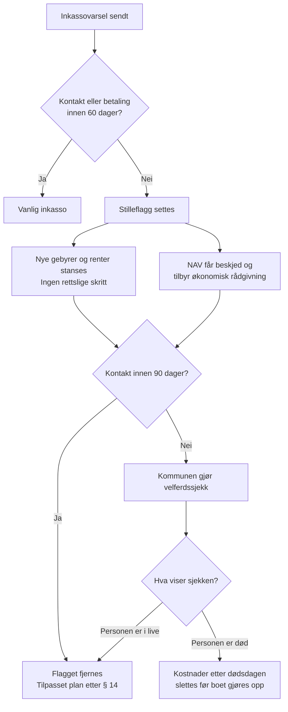

# Forslag: Stilleflagget

*Versjon 1, oktober 2026. Bygger på [analysen](analyse.md) og [rettskartet](rettskart.md). English summary at the bottom.*

*Forslaget er ute til gjennomgang. Se [spørsmålene vi trenger svar på](gjennomgang.md). The proposal is open for review: see [the questions we need answered](gjennomgang.md#english).*

## Kort oppsummert

Når en skyldner har vært helt stille over tid, skal inkassoforetaket sette et **stilleflagg**. Flagget stopper nye gebyrer, sender et signal til NAV om å ta kontakt, og fører til en velferdssjekk hvis stillheten fortsetter. Gjelden slettes ikke, men den vokser ikke mens ingen vet om personen har det bra. Hvis det viser seg at personen var død, slettes alle kostnader som løp etter dødsdagen.

Alle tall i forslaget er utgangspunkt for diskusjon, ikke endelige.

## Slik virker det

## De fem delene

### 1. Utløser: stillhet blir et signal

- Flagget settes når skyldneren ikke har svart på noen kanal (brev, digital post, SMS eller telefon) og ikke har betalt noe, i **60 dager etter inkassovarselet**.
- Inkassoforetaket må sette flagget før saken kan gå videre til tungt salær eller rettslig inndriving.
- Flagget gjelder personen, ikke saken. Har én kreditor flagget en person, ser andre kreditorer det også (se del 4).

*Svarer på hull 1: stillhet utløser ingenting.*

### 2. Gebyrstopp

- Mens flagget er aktivt, kan det ikke legges på nye inkassokostnader, og forsinkelsesrenter stanses.
- Ingen rettslige skritt (forliksråd, utlegg, trekk i lønn) mens flagget er aktivt.
- Gebyrstoppet varer til kontakt er oppnådd, men maksimalt **6 måneder**. Deretter kan saken gå videre, men bare etter en manuell vurdering.

*Svarer på hull 1 og 5.*

### 3. Henvisning til hjelp

- Når flagget settes, får NAV-kontoret i skyldnerens kommune et varsel med bare navn og adresse. Varselet sier ikke hvem kreditoren er eller hvor mye det gjelder.
- NAV skal da tilby økonomisk rådgivning, slik kommunen allerede har plikt til, med brev og tilbud om hjemmebesøk.
- Skyldneren kan når som helst ta kontakt direkte, og da fjernes flagget.

*Svarer på hull 3: hjelp må oppsøkes.*

### 4. Ett felles flagg

- En enkel offentlig flaggtjeneste der inkassoforetak kan sette og lese et ja/nei-flagg for en person. Ingen beløp, ingen diagnoser, ingen kreditornavn.
- Helsetjenesten, NAV eller en verge kan sette et **pauseflagg** med personens samtykke, eller uten samtykke når personen ikke kan gi det og det er i personens vitale interesse. Pauseflagget gir samme gebyrstopp, uten å si hvorfor.
- Flagget slettes automatisk når det ikke lenger er aktivt.

*Svarer på hull 2 og 4: de som vet, kan ikke si fra, og ingen ser helheten.*

### 5. Velferdssjekk og uoppdagede dødsfall

- Hvis stillheten varer **90 dager etter at flagget ble satt**, skal kommunen gjøre en velferdssjekk, ved behov sammen med politiet.
- Hvis personen viser seg å være død, skal alle inkassokostnader og renter som løp etter dødsdagen falle bort. Har boet eller arvingene allerede betalt dem, skal de betales tilbake.

*Svarer på hull 5: døden tar ingen pause i gebyrene.*

## Vern mot misbruk

- **Gjelden består.** Flagget stopper bare at kravet vokser. Hovedstolen skal fortsatt betales.
- **Man kan ikke flagge seg selv for å slippe unna.** Den som tar kontakt, får fjernet flagget og en betalingsplan tilpasset evnen sin.
- **Tidsgrense.** Gebyrstoppet varer maksimalt 6 måneder, og et nytt flagg på samme krav krever en ny periode med stillhet.
- **Tilsyn.** Finanstilsynet fører tilsyn med at foretakene setter og fjerner flagg riktig.

## Lovendringer som trengs

| Lov | Endring |
| --- | --- |
| Inkassoloven | Plikt til å sette stilleflagg etter 60 dager, gebyrstopp mens flagget er aktivt, og bortfall av kostnader etter dødsdagen |
| Inkassoforskriften | Detaljregler for flaggtjenesten og frister |
| Sosialtjenesteloven | Hjemmel for at NAV kan motta flagget og ta kontakt |
| Helsepersonelloven og personvernregelverket | Hjemmel for pauseflagg uten helseopplysninger |
| Lov eller forskrift om kommunale tjenester | Plikt til velferdssjekk etter 90 dager med flagg |

## Åpne spørsmål

- [ ] Er 60 og 90 dager riktige frister? Hva sier gjeldsrådgivere og helsearbeidere?
- [ ] Hvem bør drive flaggtjenesten: Finanstilsynet, NAV, Digdir eller Gjeldsregisteret?
- [ ] Hva koster en velferdssjekk for kommunen, og hvem betaler?
- [ ] Hvordan unngår vi at flagget blir et stempel som hindrer folk i å få lån senere?
- [ ] Kan GDPRs regel om vitale interesser bære pauseflagget? Dette må jurister vurdere.
- [ ] Bør flagget også gjelde namsmannen og Skatteetaten, slik at ingen får trekk i lønn eller trygd beregnet med standardsatser før noen har fått kontakt? Se hull 6 i [rettskartet](rettskart.md).
- [ ] Bør den som er syk eller har vært stille, kunne få betalingsavtale for skatt over mer enn 12 måneder, også etter at varselet er sendt?

---

## English summary: the Silence Flag

When a debtor has been completely silent for a while, the collector sets a **silence flag**. Debt is not cancelled, but it stops growing while nobody knows whether the person is OK. All numbers are starting points for discussion.

1. **Trigger:** no reply on any channel and no payment for 60 days after the collection notice. The flag applies to the person across all creditors.
2. **Fee freeze:** no new collection costs, interest or legal steps while the flag is active, for up to 6 months.
3. **Referral:** NAV receives only the name and address and offers financial advice, including a home visit.
4. **One shared flag:** a minimal public flag service holding only a yes/no flag. Health services, NAV or a guardian can set a pause flag without saying why.
5. **Welfare check:** after 90 more days of silence, the municipality checks on the person. If they had died, all costs added after the date of death are cancelled or refunded.

Safeguards: the principal debt remains, anyone who makes contact gets a normal payment plan, flags expire, and Finanstilsynet supervises. The proposal requires changes to the Debt Collection Act and regulations, the Social Services Act, and privacy and health legislation.
