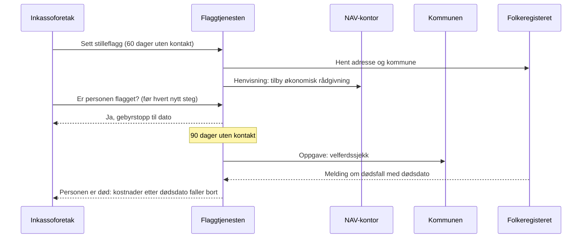

# Teknisk konsept: flaggtjenesten

*Versjon 1, oktober 2026. Bygger på [forslaget](forslag.md). English summary at the bottom.*

## Kort oppsummert

Flaggtjenesten er en liten offentlig tjeneste som bare vet én ting om en person: om det finnes et aktivt flagg, og til hvilken dato gebyrene er stoppet. Den lagrer ingen beløp, ingen diagnoser og ingen kreditornavn som andre kan se. Den bygger på fellesløsninger staten allerede har, slik at ingen nye registre om folks økonomi eller helse trengs.

En enkel [prototype av reglene](../prototype/README.md) ligger i repoet.

## Hvem gjør hva

| Aktør | Kan gjøre | Ser |
| --- | --- | --- |
| Inkassoforetak | Sette stilleflagg, fjerne eget flagg ved kontakt, spørre om en person de har aktiv sak på er flagget | Ja/nei og dato for gebyrstopp |
| Helsetjenesten, NAV, verge | Sette og fjerne pauseflagg | Ja/nei for egne flagg |
| NAV-kontoret i kommunen | Motta henvisning når et stilleflagg settes | Navn og adresse, ingenting om gjelden |
| Kommunen | Motta oppgave om velferdssjekk etter 90 dager | Navn og adresse |
| Personen selv | Se egne flagg og hvem som har satt dem (innsyn) | Alt om seg selv |
| Finanstilsynet | Kontrollere loggen | Hvem som satte og fjernet flagg, og når |

## Slik flyter det

## Byggeklosser som finnes i dag

- **Maskinporten** (Digdir) for at foretak og etater skal kunne logge inn maskin-til-maskin, med egne tilganger per rolle.
- **ID-porten** for at personen selv kan logge inn og se egne flagg.
- **Folkeregisteret** for adresse, kommune og melding om dødsfall.
- **Eksisterende kanaler mellom NAV og kommunene** for henvisninger, i stedet for en ny kanal.

## Personvern innebygd

1. **Dataminimering.** Tjenesten lagrer bare et pseudonym for personen, flaggtype, tidspunkter og hvem som satte flagget. Ingen beløp, ingen helseopplysninger.
2. **Pseudonym.** Fødselsnummeret gjøres om til en nøkkelbasert hash (HMAC) med en hemmelig nøkkel som bare tjenesten har. Uten nøkkelen kan ingen koble flagget til en person.
3. **Ikke fritt søk.** Et foretak kan bare spørre om personer det har en aktiv sak på, og hvert oppslag logges. Det hindrer at tjenesten blir et register over hvem som har gjeldsproblemer.
4. **Ingen kredittvurdering.** Det skal være forbudt å bruke flagget til kredittvurdering eller annet enn gebyrstopp og hjelp.
5. **Sletting.** Et flagg slettes 12 måneder etter at det ble avsluttet. Loggen for tilsyn beholdes i samme periode.
6. **Innsyn.** Personen kan alltid se egne flagg og hvem som satte dem.
7. **Personvernkonsekvensvurdering (DPIA)** må gjøres før tjenesten kan tas i bruk.

## Sikkerhet

- Kryptert transport (TLS) og tilgangsnøkler fra Maskinporten med smale tilganger per rolle.
- Grenser for hvor mange oppslag et foretak kan gjøre, for å oppdage misbruk.
- Varsel til Finanstilsynet ved uvanlige mønstre, for eksempel mange flagg som settes og fjernes raskt.

## Åpne spørsmål

- [ ] Hvem skal eie og drive tjenesten?
- [ ] Holder en HMAC-pseudonymisering når tjenesten selv har nøkkelen? Bør nøkkelen ligge hos en tredjepart?
- [ ] Hvordan dokumenterer foretaket at det har prøvd å få kontakt i 60 dager?
- [ ] Hvor lenge må loggen lagres for at tilsyn skal være mulig?

---

## English summary: the flag service

A small public service that knows only one thing about a person: whether there is an active flag, and until which date fees are frozen. It stores no amounts, no diagnoses, and no creditor names visible to others, and it reuses existing national building blocks: Maskinporten for machine logins, ID-porten for personal access, the Population Register for address and death notices, and existing NAV and municipal channels.

- **Collectors** set silence flags and can only look up people they have an active case on; every lookup is logged.
- **Health services, NAV and guardians** can set pause flags without giving a reason.
- **NAV** receives a referral with only a name and address; **municipalities** receive welfare-check tasks after 90 days.
- **People** can see their own flags; **Finanstilsynet** audits the log.
- **Privacy by design:** HMAC pseudonyms, no free search, a ban on using flags for credit scoring, deletion 12 months after a flag ends, and a DPIA before launch.

A small [prototype of the rules](../prototype/README.md) is included in the repository.
